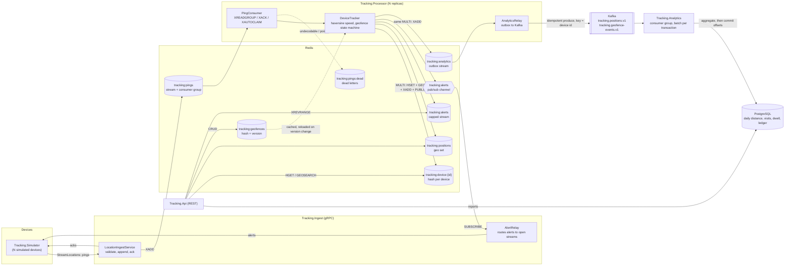

# realtime-location-tracking

A real-time geo-tracking pipeline in .NET 8. Devices stream location pings to a gRPC service over
one long-lived bidirectional stream each. Pings are appended to a Redis Stream, processed by a pool
of workers in a Redis consumer group, and turned into each device's latest position, speed and
heading, plus enter/exit alerts for circle and polygon geofences. Alerts are pushed back to the
device on its open stream. A small REST API serves latest positions, "devices near a point"
queries and geofence CRUD.

Alongside the live path, every committed position and geofence transition is written to a
transactional outbox, relayed to Kafka by an idempotent producer, and consumed into PostgreSQL by an
analytics service. The API serves reports from there: distance per device per day, time spent
inside each geofence, and dwell events. The four services export OpenTelemetry metrics in
Prometheus format.

## Architecture



### What each project does

| Project | Role |
| --- | --- |
| `Tracking.Core` | Domain model with no infrastructure dependencies: `GeoMath` (haversine distance, bearing, destination, speed), `CircleGeofence` / `PolygonGeofence`, `GeofenceStateMachine`, the pure `DeviceTracker` transition, the stream entry codec and the storage abstractions. |
| `Tracking.Contracts` | `tracking/v1/location_ingest.proto` and the generated client/server code, plus wire/domain mapping. |
| `Tracking.Infrastructure` | StackExchange.Redis implementations of the abstractions (including the analytics outbox), a resilient shared connection, DI registration, a Redis health check and the OpenTelemetry/Prometheus wiring. |
| `Tracking.Ingest` | gRPC service. Validates each ping, appends it in pipelined batches with `XADD MAXLEN ~`, acks it in order, forwards alerts for devices connected to this instance and drains open streams on shutdown. |
| `Tracking.Processor` | Background worker. One consumer per instance in the `processors` group; commits device state, alerts and analytics events, and relays the analytics outbox to Kafka. |
| `Tracking.Kafka` | Confluent.Kafka producer (idempotent, keyed by device id) and the batch consumer used by the analytics service. |
| `Tracking.Analytics.Data` | EF Core model and migrations for the analytics database, the idempotent aggregator and the report queries. |
| `Tracking.Analytics` | Worker that consumes both analytics topics into PostgreSQL, migrates the schema on start and prunes the idempotency ledger. |
| `Tracking.Api` | Minimal API for positions, nearby search, geofences, recent alerts and, when an analytics database is configured, the analytics reports. |
| `Tracking.Simulator` | Console client that streams N simulated devices and can create demo geofences through the API. |

### The streaming contract

```proto
service LocationIngest {
  rpc StreamLocations(stream LocationPing) returns (stream ServerMessage);
}
```

A device opens one call with an `x-device-id` header and keeps it open. Every `LocationPing`
carries a client `sequence`; the server answers each with a `PingAck` (same sequence, `accepted`,
the Redis entry id, or a `reason` and a `retryable` flag). `GeofenceAlert` messages for that device
are interleaved on the same response stream as the processor produces them.

## Running it

Prerequisites: the .NET 8 SDK (`global.json` pins 8.0.x with `rollForward: latestFeature`) and,
for the containerised options, Docker.

### Local processes

```bash
# Redis, Kafka (with its topics) and PostgreSQL from the compose file
docker compose up -d redis kafka kafka-init postgres

dotnet build
dotnet run --project src/Tracking.Ingest      # gRPC on localhost:5100, health and metrics on :5101
dotnet run --project src/Tracking.Processor   # health and metrics on localhost:5300
dotnet run --project src/Tracking.Analytics   # health and metrics on localhost:5400
dotnet run --project src/Tracking.Api         # REST on localhost:5200

# 50 devices, one ping every 500 ms, for 30 seconds, with demo geofences
dotnet run --project src/Tracking.Simulator -- \
  --ingest http://localhost:5100 --api http://localhost:5200 \
  --devices 50 --interval 00:00:00.500 --duration 00:00:30 --seed 42
```

Then query the API, for example with the requests in
[`src/Tracking.Api/Tracking.Api.http`](src/Tracking.Api/Tracking.Api.http):

```bash
curl "http://localhost:5200/api/devices/sim-0001/position"
curl "http://localhost:5200/api/devices/nearby?lat=52.3731&lon=4.8926&radiusMeters=2000&maxAgeSeconds=60"
curl "http://localhost:5200/api/alerts?limit=20"

# Analytics reports (they trail the live state by the time events take to pass through Kafka)
curl "http://localhost:5200/api/analytics/devices/sim-0001/distance?from=2026-10-20&to=2026-10-27"
curl "http://localhost:5200/api/analytics/devices/sim-0001/geofence-time"
curl "http://localhost:5200/api/analytics/dwell-events?limit=20"
```

Only Redis is required for the live path. Set `Processor:PublishAnalytics=false` to run the processor
without Kafka, and leave `ConnectionStrings:Analytics` unset to run the API without the reports.

### Docker Compose

```bash
docker compose up --build
```

This starts Redis, a single-node Kafka in KRaft mode (a one-shot `kafka-init` creates both topics
with 6 partitions), PostgreSQL, one ingest instance, two processor replicas (each its own consumer in
the group, and each running a relay), the analytics service, the API and a simulator with 25 devices
that also creates the demo geofences. Host ports: gRPC `5100`, ingest health `5101`, API `5200`,
analytics health `5400`, Redis `6379`, Kafka `9092`, PostgreSQL `5432`. `docker compose down -v`
removes everything including the data volumes.

### Kubernetes

`deploy/k8s` is a Kustomize base: a `tracking` namespace, a ConfigMap, StatefulSets with persistent
volumes for Redis, Kafka (one KRaft broker) and PostgreSQL, a Job that creates the Kafka topics,
Deployments and Services for ingest, processor, analytics and API, HorizontalPodAutoscalers for
ingest and processor, PodDisruptionBudgets, startup/readiness/liveness probes and resource
requests/limits. The analytics database credentials come from a generated `analytics-db` secret
whose development values must be replaced before deploying anywhere that matters.

```bash
kubectl kustomize deploy/k8s          # render
kubectl apply -k deploy/k8s           # apply to the current context
```

The manifests reference the `tracking-*:local` images that `docker compose build` produces, which
suits a local cluster that can load them (for example `kind load docker-image tracking-ingest:local`,
and likewise for `tracking-processor`, `tracking-analytics` and `tracking-api`).
For a registry, set the images with `kustomize edit set image`. The HPAs scale on CPU, so the
cluster needs metrics-server.

## Observability

Ingest, processor, analytics and API serve Prometheus metrics at `/metrics` on their HTTP port (for ingest, the HTTP/1.1
health port `5101`), next to `/healthz/live` and `/healthz/ready`. Besides the ASP.NET Core and .NET
runtime instruments, the services publish:

| Metric | Service | Meaning |
| --- | --- | --- |
| `tracking.ingest.pings` | ingest | Pings received, by outcome (`accepted`, `rejected`, `unavailable`). |
| `tracking.ingest.append.latency`, `tracking.ingest.append.batch_size` | ingest | Time and size of each pipelined append to Redis. |
| `tracking.ingest.streams.active` | ingest | Open device streams. |
| `tracking.processor.entries` | processor | Stream entries handled, by outcome (`applied`, `stale`, `dead_lettered`). |
| `tracking.processor.latency` | processor | Time from a ping being appended to its state change being committed. |
| `tracking.stream.lag`, `tracking.stream.pending`, `tracking.stream.length` | processor | Consumer group backlog: undelivered, delivered but unacknowledged, and held entries. |
| `tracking.kafka.produced`, `tracking.kafka.produce.errors` | processor | Analytics events acknowledged and rejected by Kafka. |
| `tracking.analytics.events` | analytics | Events consumed, by outcome (`applied`, `duplicate`, `invalid`). |
| `tracking.analytics.apply.latency` | analytics | Time to apply one batch to PostgreSQL, including its transaction. |
| `tracking.redis.connected`, `tracking.redis.connection.events` | all Redis clients | Whether the multiplexer is connected, and its connection failures and restorations. |

Latency histograms are recorded in seconds, with buckets from 1 ms to 30 s.

## Configuration

Every setting can be supplied through `appsettings.json`, environment variables (`Section__Key`)
or command-line arguments (`--Section:Key=value`).

| Setting | Default | Used by | Meaning |
| --- | --- | --- | --- |
| `Redis:ConnectionString` | `localhost:6379` | ingest, processor, API | StackExchange.Redis configuration string. |
| `Redis:KeyPrefix` | `tracking` | all | Prefix for every Redis key. |
| `Redis:ConsumerGroup` | `processors` | processor | Consumer group on the ping stream. |
| `Redis:PingStreamMaxLength` | `1000000` | ingest | Approximate `MAXLEN` cap on the ping stream. |
| `Redis:AlertLogMaxLength` | `10000` | processor | Approximate cap on the alert log. |
| `Redis:DeadLetterMaxLength` | `100000` | processor | Approximate cap on the dead-letter stream. |
| `Redis:AnalyticsOutboxMaxLength` | `1000000` | processor | Approximate cap on the analytics outbox; it must exceed the backlog a Kafka outage can build. |
| `Redis:AnalyticsRelayGroup` | `analytics-relay` | processor | Consumer group the relays share on the outbox. |
| `Redis:ConnectTimeout` / `OperationTimeout` | `5 s` / `5 s` | all Redis clients | Connect and per-command timeouts. |
| `Redis:ReconnectBaseDelay` / `ReconnectMaxDelay` | `500 ms` / `10 s` | all Redis clients | Exponential reconnect back-off. |
| `Redis:FailFastWhenDisconnected` | `true` | all Redis clients | Fail commands immediately while disconnected instead of queueing them until they time out. |
| `Ingest:MaxClockSkew` | `00:02:00` | ingest | How far in the future a ping timestamp may be. |
| `Ingest:MaxPingAge` | `1.00:00:00` | ingest | Older pings are rejected. |
| `Ingest:OutboxCapacity` | `256` | ingest | Messages buffered per stream before acks apply back-pressure and alerts are dropped. |
| `Ingest:InboundCapacity` | `64` | ingest | Pings read from one stream but not yet appended; when full the stream stops reading. |
| `Ingest:AppendQueueCapacity` | `4096` | ingest | Pings queued for appending across all streams on the instance. |
| `Ingest:MaxBatchSize` | `256` | ingest | Most pings sent to Redis in one pipelined batch. |
| `Ingest:DrainTimeout` | `00:00:30` | ingest | How long shutdown waits for open streams to acknowledge what they have read. |
| `Processor:ConsumerName` | host name | processor | Consumer name; must be unique per instance and stable across its restarts. |
| `Processor:BatchSize` | `100` | processor | Entries per `XREADGROUP` / `XAUTOCLAIM` call. |
| `Processor:MinIdleDelay` / `MaxIdleDelay` | `50 ms` / `1 s` | processor | Polling back-off while the stream is empty. |
| `Processor:ClaimMinIdle` | `00:00:30` | processor | Idle time before another consumer's pending entry is claimed. |
| `Processor:ClaimInterval` | `00:00:10` | processor | How often to run the claim scan. |
| `Processor:GeofenceRefreshInterval` | `00:00:02` | processor | How often the geofence version counter is checked. |
| `Processor:MaxCommitAttempts` | `5` | processor | Optimistic commit retries per ping. |
| `Processor:MaxDeliveryAttempts` | `5` | processor | Non-transient failures, counted by this consumer, before an entry is dead-lettered. |
| `Processor:MaxDeliveryCount` | `20` | processor | Deliveries counted by Redis for the whole group before an entry is dead-lettered unprocessed. |
| `Processor:ErrorDelay` / `MaxErrorDelay` | `1 s` / `30 s` | processor | Jittered exponential back-off after Redis or processing errors. |
| `Processor:LagSampleInterval` | `00:00:05` | processor | How often the consumer group backlog is sampled for the lag metrics. |
| `Processor:PublishAnalytics` | `true` | processor | Write analytics events to the outbox and relay them to Kafka. |
| `Processor:StallTimeout` | `00:01:00` | processor | Liveness fails if the loop has not iterated for this long. |
| `Kafka:BootstrapServers` | `localhost:9092` | processor, analytics | Kafka brokers. |
| `Kafka:PositionsTopic` / `GeofenceEventsTopic` | `tracking.positions.v1` / `tracking.geofence-events.v1` | processor, analytics | Analytics topics. |
| `Kafka:Acks`, `EnableIdempotence`, `LingerMs`, `Compression`, `DeliveryTimeout` | `All`, `true`, `5`, `Lz4`, `00:00:30` | processor | Producer settings. |
| `Kafka:Properties:*` | none | processor, analytics | Extra librdkafka properties, for example `security.protocol` or `sasl.mechanism`. |
| `ConnectionStrings:Analytics` | `localhost:5432/tracking_analytics` | analytics, API | Npgsql connection string. Required by the analytics service; the API maps the reports only when it is set. |
| `AnalyticsConsumer:GroupId` | `tracking-analytics` | analytics | Kafka consumer group shared by every analytics instance. |
| `AnalyticsConsumer:BatchSize` / `PollTimeout` | `500` / `1 s` | analytics | Events applied in one transaction, and how long to wait for the first one. |
| `AnalyticsService:ApplyMigrations` | `true` | analytics | Apply EF Core migrations at startup; turn off where migrations run as a separate step. |
| `AnalyticsService:LedgerRetention` / `LedgerPruneInterval` | `7 days` / `1 hour` | analytics | How long processed event ids are kept for deduplication, and how often older ones are removed. |
| `Analytics:DwellThreshold` | `00:05:00` | analytics | A completed geofence visit at least this long is recorded as a dwell event. |
| `Simulator:*` | see `SimulatorOptions` | simulator | `IngestUrl`, `ApiUrl`, `Devices`, `Interval`, `Duration`, `Seed`, centre and area radius, speed range. Short switches: `--ingest --api --devices --interval --duration --seed`. |

## Design decisions

**Redis Streams with a consumer group as the log.** Ingest only appends; processors scale out as
consumers of one group. Entries are acknowledged (`XACK`) only after their effects are committed,
so delivery is at least once. A processor first re-reads its own pending entries (after a restart or
an error), periodically claims entries that have been idle on another consumer for `ClaimMinIdle`
with `XAUTOCLAIM` (the crashed-consumer case), and then reads new entries. StackExchange.Redis does
not issue blocking commands on its multiplexed connection, so `XREADGROUP` is polled with an
exponential back-off while the stream is empty.

**Idempotency comes from timestamps, not from tracking processed ids.** `DeviceTracker` treats a
ping whose device timestamp is not strictly newer than the stored state as stale and ignores it.
That makes redeliveries harmless and also keeps a device from jumping backwards when pings for the
same device are handled out of order by different consumers.

**One conditional transaction per update.** `RedisDeviceStateStore.TryCommitAsync` writes the
device hash, the `GEOADD`, the alert log entries and the alert `PUBLISH` in one `MULTI`/`EXEC`
guarded by a condition on the stored timestamp. If another processor updated the device in the
meantime the transaction writes nothing and `PingProcessor` retries against fresh state. An alert
is therefore never published for a state that was not stored, and two processors cannot interleave
partial updates for one device.

**Geofence state lives with the device.** The ids of the geofences a device is inside are stored in
its hash, so any processor can evaluate the next ping. A device with no history starts outside every
geofence (its first fix inside one produces an enter alert). If a geofence is deleted while a device
is inside it, the membership is dropped without an exit alert.

**Failure handling in the processor.** Entries that cannot be decoded go straight to a dead-letter
stream. Entries whose processing keeps failing for non-transient reasons are dead-lettered after
`MaxDeliveryAttempts`. Redis connection errors and timeouts do not count towards that limit, so an
outage delays processing but does not discard pings. Liveness reflects only whether the consumer
loop is iterating; Redis reachability is a readiness concern.

**gRPC stream handling in ingest.** gRPC does not allow concurrent writes to a response stream, but
acks (from the read loop) and alerts (from the Redis subscription) both need it. Each call therefore
owns a bounded channel drained by a single writer task. Acks wait for space, which applies
back-pressure to that device's own stream; alerts use a non-blocking write and are dropped if the
device's buffer is full, so one slow client cannot stall alert delivery for others. A storage error
produces a `retryable` rejection instead of failing the stream.

**Alert fan-out.** Every ingest instance subscribes to the alert channel and delivers only alerts
for devices connected to it. Pub/sub is fire-and-forget: a device that is not connected when an
alert is published does not receive it on the stream, but the alert is still in the capped alert
log that the API serves.

**Bounded buffers and batched appends in ingest.** Each stream reads into a small bounded channel,
and every stream on the instance feeds one appender that sends whatever has accumulated (up to
`MaxBatchSize`) to Redis in one pipelined round trip. Batches grow with load without a timer. When
Redis slows down the queues fill, streams stop reading, and HTTP/2 flow control pushes back to the
devices instead of the server buffering for them. A single flush loop keeps each stream's pings in
order.

**Graceful drain.** On SIGTERM, ingest fails readiness and refuses new streams; every open stream
stops reading, appends and acknowledges what it already read, and ends with `UNAVAILABLE` so the
device reconnects elsewhere. A ping is therefore either acknowledged after it was stored or never
acknowledged at all.

**Poison entries are caught by the group-wide delivery count too.** `MaxDeliveryAttempts` only sees
failures that a consumer survives to count. An entry that crashes the process, or keeps being
claimed before it is acknowledged, would loop forever; so an entry whose Redis delivery count (shared
by the whole group) exceeds `MaxDeliveryCount` is dead-lettered before it is processed again.

**A resilient Redis connection.** Each service uses one shared multiplexer configured from `RedisOptions`
with explicit timeouts, keep-alives, an exponential reconnect back-off and fail-fast behaviour while
disconnected, so an outage surfaces as quick errors (and back-off in the workers) rather than a
queue of commands timing out. Connection failures and restorations are logged and exported as
metrics.

**Analytics through a transactional outbox.** The analytics event for a committed position (and one
per geofence transition) is `XADD`ed to the `tracking:analytics` stream inside the same conditional
`MULTI`/`EXEC` that writes the device state, so an event exists exactly when its state was stored,
without a two-phase commit between Redis and Kafka. Each processor also runs a relay that reads the
outbox as a consumer group and acknowledges an entry only after Kafka has acknowledged it. A Kafka
outage therefore stalls only the analytics path: pings keep being processed and the outbox absorbs
the backlog.

**Idempotent producer, keyed by device.** The producer uses `acks=all` with idempotence enabled, so
broker-side retries neither duplicate nor reorder messages. Messages are keyed by device id, so each
device's events stay on one partition.

**At-least-once consumption, exactly-once effects.** The analytics service disables automatic offset
commits. Each batch is applied in one PostgreSQL transaction that also inserts every event id into a
ledger table; an event whose id is already there is skipped. Offsets are committed only after the
transaction commits, and a batch that cannot be stored is retried with back-off without consuming
further, so the committed offset never passes an event that was not stored. A crash between the two
commits replays the batch, which the ledger turns into a no-op. Malformed messages are logged and
skipped so they cannot block a partition.

**Aggregation that does not depend on order.** Relays can interleave and retries can reorder events,
so nothing assumes order. Each position event carries the haversine distance from the device's
previous committed position (the processor already has it), so daily distance is a plain sum,
attributed to the UTC day of the later fix. Enter and exit events are paired into visits by time,
whichever arrives first; a visit that closes after at least `DwellThreshold` also produces a dwell
event.

**Health endpoints on a separate port for ingest.** The gRPC endpoint is HTTP/2 only (cleartext
HTTP/2 requires prior knowledge), so probes use a second HTTP/1.1 port.

**Planar polygon containment.** Polygons use even-odd ray casting on latitude/longitude, which is
accurate at city scale. Polygons spanning 180 degrees of longitude or more are rejected, which rules
out antimeridian crossing. Circles use the haversine distance.

## Limitations

- Redis is a single instance in both compose and Kubernetes; there is no replication or Sentinel
  configuration. Kafka is a single broker with replication factor 1, and PostgreSQL a single instance.
- Stream trimming is by length (`MAXLEN ~`). If processors are down long enough for the backlog to
  exceed the cap, the oldest unprocessed pings are trimmed.
- Consumers that disappear (for example pods removed by a scale-down) remain listed in the consumer
  group with zero pending entries once their work is claimed; nothing removes them.
- The HPAs scale on CPU. Consumer-group lag would be a better signal for the processor but needs a
  custom or external metrics adapter, which is not included.
- Kubernetes Services balance gRPC per connection, not per stream, so long-lived device streams stay
  on the ingest pod they first connected to.
- The analytics outbox is trimmed by length like the ping stream: a Kafka outage longer than the
  outbox can hold loses the oldest unrelayed events.
- Deduplication covers replays within `LedgerRetention` (7 days by default); an event replayed later,
  for example by resetting the consumer group to an old offset, would be counted again.
- Analytics reports trail the live state by the outbox, Kafka and consumer latency, and a visit whose
  enter event has not arrived yet is left out of geofence time until it does.
- There is no authentication on the gRPC or REST endpoints.

## Tests

```bash
dotnet test
```

| Project | Covers |
| --- | --- |
| `Tracking.Core.Tests` | Haversine distance, bearing, destination and speed; circle and polygon containment and validation; the enter/exit state machine; `DeviceTracker` (stale pings, speed, heading); the stream entry codec; device id rules. |
| `Tracking.Processor.Tests` | `PingConsumer` against an in-memory consumer group: acking, stale pings, dead-lettering, claiming entries from a crashed consumer (including paging), recovering own pending entries, commit-conflict retries, Redis outages, the poison-entry limits, lag metrics and analytics events; `GeofenceCache` refresh; error back-off; `AnalyticsRelay` (ack only after Kafka, retries, claiming) and the Kafka producer configuration. |
| `Tracking.Ingest.Tests` | The real gRPC service on an in-memory test server: ordered acks, header validation, ping rejection, default timestamps, retryable storage failures, alert push to the right device, session cleanup, back-pressure, batched appends and graceful drain. |
| `Tracking.Api.Tests` | REST endpoints with in-memory stores: positions, nearby search, geofence CRUD and validation, alerts, and the analytics reports against an in-memory SQLite database. |
| `Tracking.Analytics.Tests` | The aggregator (deduplication, order-independent distance and visit pairing, dwell events), the report queries and the consumer worker (offsets committed only after a batch is stored, retry while the database is down) on SQLite. The migrations are also applied to a real PostgreSQL when `TRACKING_TEST_POSTGRES` holds a connection string, and skipped otherwise. |
| `Tracking.Infrastructure.Tests` | The Redis implementations against a real Redis (consumer groups, `XAUTOCLAIM`, dead letters, conditional commits including the outbox, pub/sub, `GEOSEARCH`, geofence CRUD). They run when `TRACKING_TEST_REDIS` is set, for example `TRACKING_TEST_REDIS=localhost:6379 dotnet test`, and are skipped otherwise. CI runs them against a Redis service container. The connection settings and connection-event metrics are tested without a server. |

## Repository layout

```
.
├── src/
│   ├── Tracking.Core/             domain model and abstractions
│   ├── Tracking.Contracts/        protobuf contract (Protos/tracking/v1)
│   ├── Tracking.Infrastructure/   Redis implementations, telemetry
│   ├── Tracking.Kafka/            Kafka producer and consumer
│   ├── Tracking.Analytics.Data/   EF Core model, migrations, aggregator, reports
│   ├── Tracking.Ingest/           gRPC ingest service      (Dockerfile)
│   ├── Tracking.Processor/        consumer-group worker    (Dockerfile)
│   ├── Tracking.Analytics/        Kafka-to-PostgreSQL worker (Dockerfile)
│   ├── Tracking.Api/              REST API                 (Dockerfile, Tracking.Api.http)
│   └── Tracking.Simulator/        device simulator         (Dockerfile)
├── tests/
│   ├── Tracking.Core.Tests/
│   ├── Tracking.Processor.Tests/
│   ├── Tracking.Ingest.Tests/
│   ├── Tracking.Api.Tests/
│   ├── Tracking.Infrastructure.Tests/
│   ├── Tracking.Analytics.Tests/
│   └── Tracking.Testing/          shared in-memory fakes
├── deploy/k8s/                    Kustomize base
├── docker-compose.yml
├── .github/workflows/ci.yml
├── Directory.Build.props          net8.0, nullable, warnings as errors, analyzers
├── Directory.Packages.props       central package versions
└── global.json
```

## License

[MIT](LICENSE)
