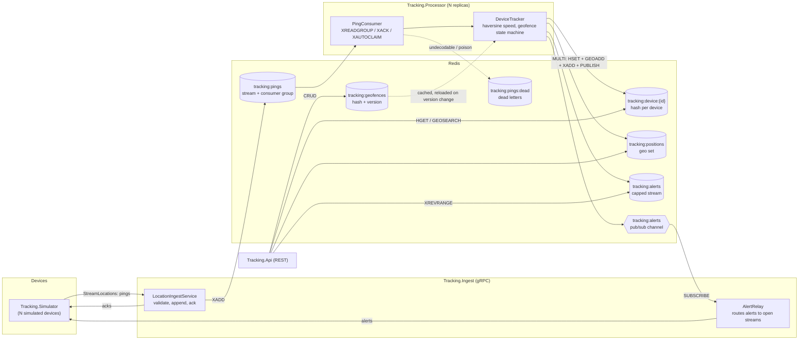

# realtime-location-tracking

A real-time geo-tracking pipeline in .NET 8. Devices stream location pings to a gRPC service over
one long-lived bidirectional stream each. Pings are appended to a Redis Stream, processed by a pool
of workers in a Redis consumer group, and turned into each device's latest position, speed and
heading, plus enter/exit alerts for circle and polygon geofences. Alerts are pushed back to the
device on its open stream. A small REST API serves latest positions, "devices near a point"
queries and geofence CRUD.

## Architecture



### What each project does

| Project | Role |
| --- | --- |
| `Tracking.Core` | Domain model with no infrastructure dependencies: `GeoMath` (haversine distance, bearing, destination, speed), `CircleGeofence` / `PolygonGeofence`, `GeofenceStateMachine`, the pure `DeviceTracker` transition, the stream entry codec and the storage abstractions. |
| `Tracking.Contracts` | `tracking/v1/location_ingest.proto` and the generated client/server code, plus wire/domain mapping. |
| `Tracking.Infrastructure` | StackExchange.Redis implementations of the abstractions, DI registration and a Redis health check. |
| `Tracking.Ingest` | gRPC service. Validates each ping, appends it with `XADD MAXLEN ~`, acks it in order and forwards alerts for devices connected to this instance. |
| `Tracking.Processor` | Background worker. One consumer per instance in the `processors` group; commits device state and alerts. |
| `Tracking.Api` | Minimal API for positions, nearby search, geofences and recent alerts. |
| `Tracking.Simulator` | Console client that streams N simulated devices and can create demo geofences through the API. |

### The streaming contract

```proto
service LocationIngest {
  rpc StreamLocations(stream LocationPing) returns (stream ServerMessage);
}
```

A device opens one call with an `x-device-id` header and keeps it open. Every `LocationPing`
carries a client `sequence`; the server answers each with a `PingAck` (same sequence, `accepted`,
the Redis entry id, or a `reason` and a `retryable` flag). `GeofenceAlert` messages for that device
are interleaved on the same response stream as the processor produces them.

## Running it

Prerequisites: the .NET 8 SDK (`global.json` pins 8.0.x with `rollForward: latestFeature`) and,
for the containerised options, Docker.

### Local processes

```bash
docker run -d --name tracking-redis -p 6379:6379 redis:7.4-alpine

dotnet build
dotnet run --project src/Tracking.Ingest      # gRPC on localhost:5100, health on :5101
dotnet run --project src/Tracking.Processor   # health on localhost:5300
dotnet run --project src/Tracking.Api         # REST on localhost:5200

# 50 devices, one ping every 500 ms, for 30 seconds, with demo geofences
dotnet run --project src/Tracking.Simulator -- \
  --ingest http://localhost:5100 --api http://localhost:5200 \
  --devices 50 --interval 00:00:00.500 --duration 00:00:30 --seed 42
```

Then query the API, for example with the requests in
[`src/Tracking.Api/Tracking.Api.http`](src/Tracking.Api/Tracking.Api.http):

```bash
curl "http://localhost:5200/api/devices/sim-0001/position"
curl "http://localhost:5200/api/devices/nearby?lat=52.3731&lon=4.8926&radiusMeters=2000&maxAgeSeconds=60"
curl "http://localhost:5200/api/alerts?limit=20"
```

### Docker Compose

```bash
docker compose up --build
```

This starts Redis, one ingest instance, two processor replicas (each its own consumer in the
group), the API and a simulator with 25 devices that also creates the demo geofences. Host ports:
gRPC `5100`, ingest health `5101`, API `5200`, Redis `6379`. `docker compose down -v` removes
everything including the Redis volume.

### Kubernetes

`deploy/k8s` is a Kustomize base: a `tracking` namespace, a ConfigMap, a Redis StatefulSet with a
persistent volume, Deployments and Services for ingest, processor and API, HorizontalPodAutoscalers
for ingest and processor, PodDisruptionBudgets, readiness/liveness probes and resource
requests/limits.

```bash
kubectl kustomize deploy/k8s          # render
kubectl apply -k deploy/k8s           # apply to the current context
```

The manifests reference the `tracking-*:local` images that `docker compose build` produces, which
suits a local cluster that can load them (for example `kind load docker-image tracking-ingest:local`).
For a registry, set the images with `kustomize edit set image`. The HPAs scale on CPU, so the
cluster needs metrics-server.

## Configuration

Every setting can be supplied through `appsettings.json`, environment variables (`Section__Key`)
or command-line arguments (`--Section:Key=value`).

| Setting | Default | Used by | Meaning |
| --- | --- | --- | --- |
| `Redis:ConnectionString` | `localhost:6379` | ingest, processor, API | StackExchange.Redis configuration string. |
| `Redis:KeyPrefix` | `tracking` | all | Prefix for every Redis key. |
| `Redis:ConsumerGroup` | `processors` | processor | Consumer group on the ping stream. |
| `Redis:PingStreamMaxLength` | `1000000` | ingest | Approximate `MAXLEN` cap on the ping stream. |
| `Redis:AlertLogMaxLength` | `10000` | processor | Approximate cap on the alert log and dead-letter stream. |
| `Ingest:MaxClockSkew` | `00:02:00` | ingest | How far in the future a ping timestamp may be. |
| `Ingest:MaxPingAge` | `1.00:00:00` | ingest | Older pings are rejected. |
| `Ingest:OutboxCapacity` | `256` | ingest | Messages buffered per stream before acks apply back-pressure and alerts are dropped. |
| `Processor:ConsumerName` | host name | processor | Consumer name; must be unique per instance and stable across its restarts. |
| `Processor:BatchSize` | `100` | processor | Entries per `XREADGROUP` / `XAUTOCLAIM` call. |
| `Processor:MinIdleDelay` / `MaxIdleDelay` | `50 ms` / `1 s` | processor | Polling back-off while the stream is empty. |
| `Processor:ClaimMinIdle` | `00:00:30` | processor | Idle time before another consumer's pending entry is claimed. |
| `Processor:ClaimInterval` | `00:00:10` | processor | How often to run the claim scan. |
| `Processor:GeofenceRefreshInterval` | `00:00:02` | processor | How often the geofence version counter is checked. |
| `Processor:MaxCommitAttempts` | `5` | processor | Optimistic commit retries per ping. |
| `Processor:MaxDeliveryAttempts` | `5` | processor | Non-transient failures before an entry is dead-lettered. |
| `Processor:StallTimeout` | `00:01:00` | processor | Liveness fails if the loop has not iterated for this long. |
| `Simulator:*` | see `SimulatorOptions` | simulator | `IngestUrl`, `ApiUrl`, `Devices`, `Interval`, `Duration`, `Seed`, centre and area radius, speed range. Short switches: `--ingest --api --devices --interval --duration --seed`. |

## Design decisions

**Redis Streams with a consumer group as the log.** Ingest only appends; processors scale out as
consumers of one group. Entries are acknowledged (`XACK`) only after their effects are committed,
so delivery is at least once. A processor first re-reads its own pending entries (after a restart or
an error), periodically claims entries that have been idle on another consumer for `ClaimMinIdle`
with `XAUTOCLAIM` (the crashed-consumer case), and then reads new entries. StackExchange.Redis does
not issue blocking commands on its multiplexed connection, so `XREADGROUP` is polled with an
exponential back-off while the stream is empty.

**Idempotency comes from timestamps, not from tracking processed ids.** `DeviceTracker` treats a
ping whose device timestamp is not strictly newer than the stored state as stale and ignores it.
That makes redeliveries harmless and also keeps a device from jumping backwards when pings for the
same device are handled out of order by different consumers.

**One conditional transaction per update.** `RedisDeviceStateStore.TryCommitAsync` writes the
device hash, the `GEOADD`, the alert log entries and the alert `PUBLISH` in one `MULTI`/`EXEC`
guarded by a condition on the stored timestamp. If another processor updated the device in the
meantime the transaction writes nothing and `PingProcessor` retries against fresh state. An alert
is therefore never published for a state that was not stored, and two processors cannot interleave
partial updates for one device.

**Geofence state lives with the device.** The ids of the geofences a device is inside are stored in
its hash, so any processor can evaluate the next ping. A device with no history starts outside every
geofence (its first fix inside one produces an enter alert). If a geofence is deleted while a device
is inside it, the membership is dropped without an exit alert.

**Failure handling in the processor.** Entries that cannot be decoded go straight to a dead-letter
stream. Entries whose processing keeps failing for non-transient reasons are dead-lettered after
`MaxDeliveryAttempts`. Redis connection errors and timeouts do not count towards that limit, so an
outage delays processing but does not discard pings. Liveness reflects only whether the consumer
loop is iterating; Redis reachability is a readiness concern.

**gRPC stream handling in ingest.** gRPC does not allow concurrent writes to a response stream, but
acks (from the read loop) and alerts (from the Redis subscription) both need it. Each call therefore
owns a bounded channel drained by a single writer task. Acks wait for space, which applies
back-pressure to that device's own stream; alerts use a non-blocking write and are dropped if the
device's buffer is full, so one slow client cannot stall alert delivery for others. A storage error
produces a `retryable` rejection instead of failing the stream.

**Alert fan-out.** Every ingest instance subscribes to the alert channel and delivers only alerts
for devices connected to it. Pub/sub is fire-and-forget: a device that is not connected when an
alert is published does not receive it on the stream, but the alert is still in the capped alert
log that the API serves.

**Health endpoints on a separate port for ingest.** The gRPC endpoint is HTTP/2 only (cleartext
HTTP/2 requires prior knowledge), so probes use a second HTTP/1.1 port.

**Planar polygon containment.** Polygons use even-odd ray casting on latitude/longitude, which is
accurate at city scale. Polygons spanning 180 degrees of longitude or more are rejected, which rules
out antimeridian crossing. Circles use the haversine distance.

## Limitations

- Redis is a single instance in both compose and Kubernetes; there is no replication or Sentinel
  configuration.
- Stream trimming is by length (`MAXLEN ~`). If processors are down long enough for the backlog to
  exceed the cap, the oldest unprocessed pings are trimmed.
- Consumers that disappear (for example pods removed by a scale-down) remain listed in the consumer
  group with zero pending entries once their work is claimed; nothing removes them.
- The HPAs scale on CPU. Consumer-group lag would be a better signal for the processor but needs a
  custom or external metrics adapter, which is not included.
- Kubernetes Services balance gRPC per connection, not per stream, so long-lived device streams stay
  on the ingest pod they first connected to.
- There is no authentication on the gRPC or REST endpoints.

## Tests

```bash
dotnet test
```

| Project | Covers |
| --- | --- |
| `Tracking.Core.Tests` | Haversine distance, bearing, destination and speed; circle and polygon containment and validation; the enter/exit state machine; `DeviceTracker` (stale pings, speed, heading); the stream entry codec; device id rules. |
| `Tracking.Processor.Tests` | `PingConsumer` against an in-memory consumer group: acking, stale pings, dead-lettering, claiming entries from a crashed consumer (including paging), recovering own pending entries, commit-conflict retries, Redis outages and the poison-entry limit; `GeofenceCache` refresh. |
| `Tracking.Ingest.Tests` | The real gRPC service on an in-memory test server: ordered acks, header validation, ping rejection, default timestamps, retryable storage failures, alert push to the right device and session cleanup. |
| `Tracking.Api.Tests` | REST endpoints with in-memory stores: positions, nearby search, geofence CRUD and validation, alerts. |
| `Tracking.Infrastructure.Tests` | The Redis implementations against a real Redis (consumer groups, `XAUTOCLAIM`, dead letters, conditional commits, pub/sub, `GEOSEARCH`, geofence CRUD). They run when `TRACKING_TEST_REDIS` is set, for example `TRACKING_TEST_REDIS=localhost:6379 dotnet test`, and are skipped otherwise. CI runs them against a Redis service container. |

## Repository layout

```
.
├── src/
│   ├── Tracking.Core/             domain model and abstractions
│   ├── Tracking.Contracts/        protobuf contract (Protos/tracking/v1)
│   ├── Tracking.Infrastructure/   Redis implementations
│   ├── Tracking.Ingest/           gRPC ingest service      (Dockerfile)
│   ├── Tracking.Processor/        consumer-group worker    (Dockerfile)
│   ├── Tracking.Api/              REST API                 (Dockerfile, Tracking.Api.http)
│   └── Tracking.Simulator/        device simulator         (Dockerfile)
├── tests/
│   ├── Tracking.Core.Tests/
│   ├── Tracking.Processor.Tests/
│   ├── Tracking.Ingest.Tests/
│   ├── Tracking.Api.Tests/
│   ├── Tracking.Infrastructure.Tests/
│   └── Tracking.Testing/          shared in-memory fakes
├── deploy/k8s/                    Kustomize base
├── docker-compose.yml
├── .github/workflows/ci.yml
├── Directory.Build.props          net8.0, nullable, warnings as errors, analyzers
├── Directory.Packages.props       central package versions
└── global.json
```

## License

[MIT](LICENSE)
